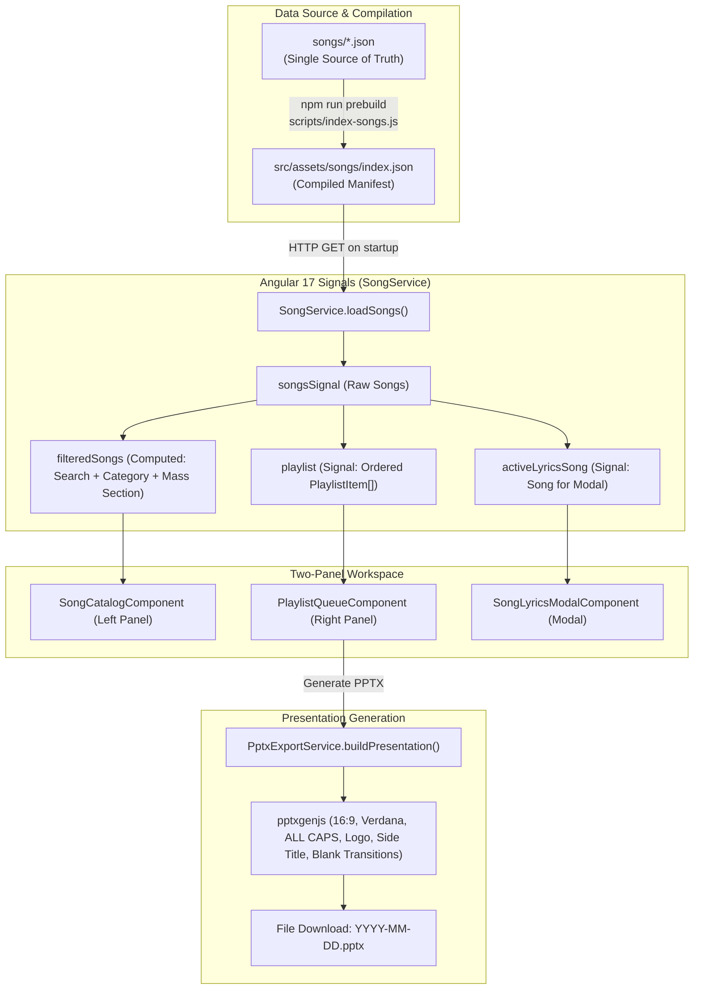

# PPTX Maker - AI & Developer Project Guide

> **Note for AI Agents & Developers:** This document provides a complete, structured overview of the PPTX Lyrics Presentation Maker codebase. Use this document when onboarding, analyzing the project for the first time, or continuing development.

---

## 1. Project Overview & Purpose

**PPTX Maker** is a client-side Single-Page Application (SPA) built with **Angular 17 (Standalone Components & Signals)** and deployed to **GitHub Pages**.

It enables worship leaders, choir conductors, and event organizers to:
1. Search and browse a structured repository of songs (with categories and liturgical mass sections).
2. Preview complete song lyrics in an accessible modal dialog.
3. Queue songs into an ordered playlist with live slide count estimation.
4. Export and download a ready-to-project **PowerPoint presentation (`.pptx`)** generated directly in the browser via `pptxgenjs`.
5. Submit requests for new songs via an email-forwarded modal dialog.

The entire app is **100% static client-side** (zero backend server required).

---

## 2. Tech Stack & Dependencies

| Layer | Technology | Purpose |
|---|---|---|
| **Framework** | Angular 17.3 (Standalone) | SPA framework without `NgModule`s |
| **Reactivity** | Angular Signals (`signal`, `computed`) | Fine-grained reactive state management |
| **Presentation Engine** | `pptxgenjs` (v4.0.1) | Client-side `.pptx` PowerPoint generator |
| **Typography & Icons** | Custom inline SVGs & standard fonts | Zero icon pack overhead, crisp vector UI |
| **Styling** | Modern CSS Variables & Responsive Grid | Dark slate aesthetic, mobile & desktop optimized |
| **Build & Tooling** | Angular CLI 17 + Node 20 (ESBuild) | Ultra-fast production bundle generation |
| **Testing** | Karma + Jasmine + ChromeHeadless / FirefoxHeadless | 57+ unit tests covering services, components, and export logic |
| **CI/CD** | GitHub Actions | PR validation, GitHub Pages deploy, automated SemVer tagging & releases |

---

## 3. Directory Map & File Architecture

```text
pptx_web_maker/
├── .github/
│   └── workflows/
│       ├── deploy.yml            # CI/CD: build, test, deploy to Pages, auto-tag & GitHub Release
│       └── pr-check.yml          # PR gate: typecheck, 57 unit tests, production build
├── scripts/
│   └── index-songs.js           # Build-time script: parses songs/*.json -> src/assets/songs/index.json
├── songs/                       # SINGLE SOURCE OF TRUTH: individual song JSON files
│   ├── 10,000 Reasons.json
│   ├── Amazing Grace.json
│   ├── How Great Thou Art.json
│   └── Way Maker.json
├── src/
│   ├── app/
│   │   ├── components/
│   │   │   ├── header/                # Top navigation, brand title, language toggle (HR/EN), settings & request triggers
│   │   │   ├── playlist-queue/        # Right panel: selected songs, reordering, slide count, PPTX export, settings status confirmation
│   │   │   ├── request-song-modal/    # Accessible modal for submitting song requests via email
│   │   │   ├── settings-drawer/       # Slide-over drawer for presentation aspect ratio, fonts, colors, and logo
│   │   │   ├── song-catalog/          # Left panel: live search, multi-category & mass section filter chips
│   │   │   └── song-lyrics-modal/     # Modal for previewing full lyrics, stanzas, copy to clipboard, add to queue
│   │   ├── constants/
│   │   │   ├── presentation-settings.constant.ts # Types, defaults, presets for presentation settings
│   │   │   ├── skac-logo.constant.ts  # Base64 pre-encoded SKAC white logo for PPTX slides
│   │   │   └── song-metadata.constants.ts # Presets for Categories and Mass Sections
│   │   ├── models/
│   │   │   ├── song.model.ts          # Interfaces: Song, PlaylistItem
│   │   │   └── song-request.model.ts  # Interfaces: SongRequestPayload, SubmissionResult
│   │   ├── services/
│   │   │   ├── pptx-export.service.ts # PowerPoint presentation builder and exporter
│   │   │   ├── request-song.service.ts# FormSubmit / Web3Forms email integration
│   │   │   ├── settings.service.ts    # Presentation preferences & localStorage persistence manager
│   │   │   ├── song.service.ts        # Primary state manager (songs, search, filters, playlist, lyrics modal)
│   │   │   └── translation.service.ts # Dual-language manager (Croatian primary, English secondary)
│   │   ├── app.component.ts           # Root layout: Two-panel grid, modal slots
│   │   └── app.config.ts              # Angular app provider configuration (HttpClient, animations)
│   ├── assets/
│   │   ├── images/
│   │   │   └── skac_logo_white.png    # High-resolution white SKAC logo
│   │   └── songs/
│   │       ├── index.json             # Compiled manifest consumed at runtime by SongService
│   │       └── metadata-options.json  # Discovered/preset categories & mass sections summary
│   ├── shims/
│   │   └── empty.ts                   # Webpack shim for pptxgenjs node: scheme in tests
│   ├── styles.css                     # Global design tokens, CSS variables, resets, custom scrollbars
│   ├── index.html                     # HTML root entrypoint
│   └── main.ts                        # Application bootstrap
├── angular.json                       # Angular CLI workspace config (build, serve, test targets)
├── karma.conf.js                      # Test runner configuration (ChromeHeadlessCI & FirefoxHeadless)
├── package.json                       # Scripts and project dependencies
├── tsconfig.json                      # Root TypeScript compiler options & module paths
└── tsconfig.spec.json                 # Test-specific TypeScript configuration
```

---

## 4. Data Flow & Architecture



---

## 5. Song JSON Specification (`songs/*.json`)

Each song in `songs/` must be a valid JSON file with this format:

```json
{
  "title": "Amazing Grace",
  "categories": [
    "Slavljenje",
    "Zahvala"
  ],
  "massSections": [
    "Ulazna",
    "Pričesna"
  ],
  "stanzas": [
    "Amazing grace how sweet the sound\nThat saved a wretch like me\nI once was lost, but now I'm found\nWas blind, but now I see",
    "'Twas grace that taught my heart to fear\nAnd grace my fears relieved\nHow precious did that grace appear\nThe hour I first believed"
  ]
}
```

### Fields:
- `title` *(string)*: Display title of the song.
- `categories` *(string[])*: One or more tags from presets (e.g. `Slavljenje`, `Zahvala`, `Klanjanje`, `Meditativne`) or custom strings.
- `massSections` *(string[])*: Liturgical parts of the Catholic mass (e.g. `Ulazna`, `Gospodine`, `Slava`, `Otpjevni psalam`, `Aleluja`, `Prinosna`, `Svet`, `Jaganjče`, `Pričesna`, `Završna`).
- `stanzas` *(string[])*: Array of verses/choruses. Each array item translates directly into **one presentation slide**.

---

## 6. PowerPoint Presentation Rules & Customization (`PptxExportService` & `SettingsService`)

When building presentations in `PptxExportService.buildPresentation(playlist, options)`:

1. **Slide Dimensions & Layout:**
   - **16:9 Widescreen (Default):** `LAYOUT_16x9`, 10.0" wide by 5.625" high.
   - **4:3 Standard:** `LAYOUT_4x3`, 10.0" wide by 7.5" high (for older church projectors).
2. **Background Color:** Solid color (default `#000000`, customizable with color picker and presets like `#074d97`).
3. **Typography & Styling:**
   - **Font:** Cross-platform font families (Verdana, Arial, Calibri, Trebuchet MS, Tahoma, Georgia, Times New Roman).
   - **Font Sizing:** Smart auto-fit sizing (32–44pt) or fixed font size override slider (32–48pt).
   - **Color:** Solid color (default `#FFFFFF`, customizable with presets).
   - **Layout Box:** `x: 5%`, `y: 5%`, `w: 86%`, `h: 90%`, centered, bold, ALL CAPS.
4. **Rotated Side Title:**
   - Toggle on or off (`showSideTitle`).
   - Vertically centered on right edge, rotated 270° counter-clockwise.
   - Configurable font family and font size (8–18pt).
   - Configurable horizontal offset in centimeters (0.0 cm to 3.0 cm from edge).
5. **SKAC Logo Watermark:**
   - Toggle on or off (`showLogo`).
   - Positioned in bottom-right corner relative to active slide dimensions.
   - Configurable scaling slider (50% to 180%) and transparency slider (0% to 90%, default 35%).
6. **Blank Slide Transitions:**
   - Toggle intro/outro blank slides (`blankSlideStartEnd`).
   - Toggle blank transition slides between distinct songs (`blankSlideBetweenSongs`).
7. **Total Slide Count Formula:**
   $$\text{Total Slides} = \text{Lyric Slides} + \text{Active Blank Slides}$$

---

## 7. Dual-Language Localization (`TranslationService`)

- **Primary default language:** Croatian (`hr`).
- **Secondary language:** English (`en`).
- Languages persist in `localStorage` (`pptx_maker_lang`).
- Both translations are typed strictly via `interface Translations`.
- Whenever adding new user-facing strings, add them to `Translations`, `TRANSLATIONS_HR`, and `TRANSLATIONS_EN`.

---

## 8. Unit Testing & CI/CD Workflows

- Run tests locally with:
  ```bash
  npm test
  ```
- **Test coverage:** 77 tests across 10 test suites (`*.spec.ts`).
- **PR Check Workflow (`.github/workflows/pr-check.yml`):**
  - Triggered on PRs targeting `main` and `master`.
  - Executes: `npm ci` $\rightarrow$ `npx tsc --noEmit` $\rightarrow$ `npm test` $\rightarrow$ `npm run build`.
- **Deploy & Release Workflow (`.github/workflows/deploy.yml`):**
  - Triggered on push to `main` and `master`.
  - Determines release version prior to build:
    - Inspects git tags and commit history.
    - Searches full commit message (both title and description/body) for `#major` (bumps major) or `#minor` (bumps minor); defaults to patch bump (+1).
    - Injects calculated version as `APP_VERSION` environment variable into `scripts/generate-version.js` to create `src/environments/version.ts`.
  - Builds and deploys static bundle with version embedded into header (`.version-badge`) and footer (`.app-footer`).
  - Tags the commit and publishes GitHub Release with auto-generated release notes.
